<!-- ===================== HEADER ===================== -->
<p align="center">
  
</p>

<p align="center">
  <a href="https://nowrin-sanjana.github.io">
    
  </a>
</p>

<p align="center">
  <a href="https://nowrin-sanjana.github.io"></a>
  <a href="https://www.linkedin.com/in/nowrin-sanjana18/"></a>
  <a href="mailto:gsnrnowrin@gmail.com"></a>
  <a href="https://www.pexels.com/@nowrin-sanjana-2159843098/"></a>
</p>

<p align="center">
  
  
  
</p>

---

## 👩‍💻 About me

```python
class NowrinSanjana:
    def __init__(self):
        self.role        = "Computer Science Graduate · AI/ML Researcher"
        self.education   = "B.Sc. in CS, BRAC University (2022 – 2026) · CGPA 3.78/4.00"
        self.thesis      = "Multimodal Dementia Detection with Contrastive Learning + LLM–VLM Reasoning"
        self.research    = ["Deep Learning", "NLP", "LLMs", "VLMs", "Bioinformatics", "AI in Healthcare"]
        self.leadership  = "Director of R&D, BRAC University Computer Club (2023 – 2026)"
        self.languages   = ["Bangla", "English", "Chinese (HSK 3–4)"]
        self.hobbies     = ["Photography 📷", "Graphic & Motion Design 🎨", "Coffee ☕"]
        self.looking_for = "Full-time roles & internships in ML / AI"

    def say_hi(self):
        print("Thanks for dropping by! Let's build AI that helps people. 💜💛")
```

- 🔭 Recently finished my thesis on **multimodal dementia detection** with contrastive learning and LLM–VLM guided reasoning
- 🌱 Going deeper into **PyTorch, vision-language models and retrieval-augmented learning**
- 🤝 Happy to collaborate on **AI for healthcare, NLP and bioinformatics** research
- 💬 Ask me about **Machine Learning, React, MongoDB and research workflows**
- ⚡ Fun fact: my portfolio has a hidden mini-game, [come play it](https://nowrin-sanjana.github.io/#play) 🎮

---

## 🚀 Featured projects

| Project | What it does | Stack |
|---|---|---|
| 🧠 [**Alzheimer's Stage Detection (MRI)**](https://github.com/Nowrin-Sanjana/EfficientDeepLearningModelsForAlzheimer-sStageDetectionUsingMRI_Images) | Multi-class dementia staging from MRI scans | VGG16 · ResNet50 · EfficientNetB0 |
| 🧬 **Genomic Classification (Retrieval-Augmented)** | Classifies genomic sequences using retrieved related sequences | Python · PyTorch |
| 🎬 [**Movie Recommendation System**](https://github.com/Nowrin-Sanjana/Movie_Recommendation_System) | Interactive web app that recommends movies from user preferences | Python · Recommender systems |
| 📊 [**Machine Learning Projects**](https://github.com/Nowrin-Sanjana/Machine-Learning-projects) | Breast cancer detection, telco churn, IMDB rating prediction | Scikit-learn · Pandas |
| 🎮 [**Game Console Sharing**](https://github.com/Nowrin-Sanjana/Console-Sharing) | Database-backed console lending platform | PHP · MySQL |
| 🌐 **NextYouth Web Platform** | Community platform for youth civic initiatives | MongoDB · Express · React · Node.js |

---

## 🛠️ Tech stack

**AI / ML**
<p>
  
</p>

**Web & Backend**
<p>
  
</p>

**Databases, Languages & Tools**
<p>
  
</p>

---

## 📈 GitHub stats

<p align="center">
  
  
</p>

<p align="center">
  
</p>

<p align="center">
  
</p>

---

## 🐍 Contributions

<p align="center">
  
</p>

---

## 🏆 Highlights

<table>
<tr>
<td valign="top" width="50%">

**Competitions**
- 🥇 Datathon · CUET CSE Fest 2025
- 📊 National Data Analytics Competition 2025
- 🧩 Augmedix Brain Battle 2025
- 💻 CS Spectrum: Code Crash
- ⌨️ BRACU Intra-University Programming Contest

</td>
<td valign="top" width="50%">

**Certifications** · DeepLearning.AI
- ✅ Neural Networks and Deep Learning
- ✅ Supervised Machine Learning
- ✅ Advanced Learning Algorithms
- ✅ Unsupervised Learning, Recommenders & RL

</td>
</tr>
</table>

<p align="center">
  
</p>

---

## 💭 Quote of the day

<p align="center">
  
</p>

---

<p align="center">
  
</p>


